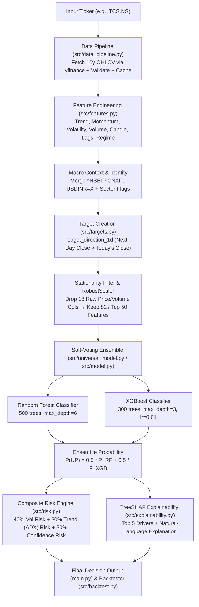

# AI-Powered Stock Decision Support System

**An explainable, multi-stock machine learning pipeline that predicts next-day NSE stock price direction, evaluates composite trading risk, and generates human-readable SHAP explanations.**

---

## 1. Project Title and One-Line Summary

**AI-Powered Stock Decision Support System** — A machine learning decision-support engine built for Indian equities (National Stock Exchange / NSE) that combines 82 engineered technical, macroeconomic, and regime features with a soft-voting Random Forest + XGBoost ensemble, composite risk scoring, and TreeSHAP explainability.

---

## 2. Problem Statement

### Real-World Problem, Target Audience, and Significance
Retail and quantitative investors in Indian equity markets face noisy daily price action, shifting market regimes, and black-box algorithmic signals that offer no transparency into *why* a trade is suggested or *how risky* current market conditions are. Additionally, models trained on a single stock often overfit to idiosyncratic history (only ~2,000 trading days in a 10-year window) and fail to generalize when macro or sector conditions shift (such as the 2024–2026 Indian IT sector correction).

This system addresses these challenges for **retail swing/positional traders, quantitative analysts, and financial data science practitioners** by:
1. **Pooling cross-stock market behavior** across 15 major NSE large-cap stocks spanning 6 sectors (~33,255 stock-days) into a **Universal Model**, while retaining a stock-specific training fallback.
2. **Quantifying multi-dimensional risk** (volatility expansion, trend choppiness via ADX, and model probability uncertainty) so traders can filter out low-conviction signals or scale down position sizes dynamically.
3. **Providing local and global explainability** via **SHAP (`TreeExplainer`)**, translating complex tree-ensemble splits into plain-English bullish and bearish drivers for every single prediction.

### Input and Output Specification
- **Input:**
  - Any valid Yahoo Finance NSE ticker symbol (e.g., `TCS.NS`, `RELIANCE.NS`, `HDFCBANK.NS`, `SUNPHARMA.NS`), plus optional CLI flags (`--refresh` to force live re-download, `--specific` to train/use a stock-specific model instead of the universal model).
  - Behind the scenes, the pipeline ingests 10 years of daily OHLCV equity data alongside 3 macro/benchmark context series: **Nifty 50 (`^NSEI`)**, **Nifty IT (`^CNXIT`)**, and **USD/INR (`USDINR=X`)**.
- **Output / Prediction:**
  - **Predicted Direction (`prediction`):** Binary next-day price movement classification — `UP` (if ensemble probability $\ge 0.50$) or `DOWN` ($< 0.50$).
  - **Calibrated Probabilities & Confidence:** `probability_up` (%), `probability_down` (%), `rf_probability` (%), `xgb_probability` (%), and scaled `confidence` ($|P(\text{UP}) - 0.5| \times 200$, ranging from `0%` to `100%`).
  - **Composite Risk Assessment:** Numeric `risk_score` $\in [0, 1]$ and categorical `risk_label` (`LOW`, `MEDIUM`, or `HIGH`).
  - **SHAP Explainability Output:** A natural-language summary (`explanation`) of top bullish/bearish drivers and a ranked list (`top_drivers`) of the top 5 features with their signed SHAP contributions.

---

## 3. Dataset / Data Source

### Source and Size
- **Source:** Yahoo Finance API via `yfinance` (`auto_adjust=True`, daily frequency, 10-year lookback `period="10y"`).
- **Raw Per-Stock Datasets (`data/raw/*.csv`):**
  - **15 NSE Large-Cap Stocks:**
    - **IT (5):** `TCS.NS`, `INFY.NS`, `WIPRO.NS`, `HCLTECH.NS`, `TECHM.NS`
    - **Banking (4):** `HDFCBANK.NS`, `ICICIBANK.NS`, `KOTAKBANK.NS`, `AXISBANK.NS`
    - **Energy (1):** `RELIANCE.NS`
    - **Consumer (2):** `HINDUNILVR.NS`, `TITAN.NS`
    - **Finance / NBFC (1):** `BAJFINANCE.NS`
    - **Auto (1):** `MARUTI.NS`
    - **Pharma (1):** `SUNPHARMA.NS`
  - **Size per raw file:** **2,467 rows × 9 columns** per stock (cached range: `2016-07-28` to `2026-07-28`).
- **Combined Universal Dataset (`data/universal_dataset.csv`):**
  - **Size:** **33,255 rows × 107 columns** (~60.7 MB).
  - **Per-Stock Coverage:** Exactly **2,217 trading days per stock** across 15 stocks (`2017-05-08` to `2026-04-29`) after dropping rolling-window warm-up rows (up to 252 days for 52-week high/low and 200-day MA) and forward target-shift rows.

### Complete Feature & Column Inventory (107 Columns)
Every row in `data/universal_dataset.csv` represents one trading day for one stock (`ticker`) and contains:

| Category | Columns (Count) | Explanation |
| :--- | :--- | :--- |
| **1. Raw OHLCV** *(Excluded from training)* | `Open`, `High`, `Low`, `Close`, `Volume` (5) | Auto-adjusted daily open, high, low, close prices (INR) and traded volume. Dropped before modeling due to non-stationarity. |
| **2. Basic Returns & Intraday Range** | `log_return`, `pct_return`, `overnight_gap`, `intraday_range` (4) | Daily log return $\ln(C_t / C_{t-1})$, simple percentage return, overnight gap $(O_t - C_{t-1})/C_{t-1}$, and normalized daily range $(H_t - L_t)/C_t$. |
| **3. Trend Indicators** | **Raw MAs/EMAs (8, excluded):** `ma_5`, `ma_10`, `ma_20`, `ma_50`, `ma_200`, `ema_9`, `ema_21`, `ema_55`<br>**Stationary Ratios & Crosses (11, used):** `close_to_ma_{5,10,20,50,200}`, `close_to_ema_{9,21,55}`, `ma_5_20_cross`, `ma_20_50_cross`, `ema_9_21_cross` (19 total) | Simple and Exponential Moving Averages across short, medium, and long horizons; relative distance of Close to each MA/EMA $(C_t - \text{MA})/\text{MA}$; and moving average crossover spreads. |
| **4. Momentum Indicators** | `rsi_9`, `rsi_14`, `rsi_21`, `roc_5`, `roc_10`, `roc_20`, `williams_r_14`, `williams_r_21`, `macd_line`, `macd_signal`, `macd_histogram` (11) | Relative Strength Index (Wilder's smoothing via `ewm(com=w-1)`), Rate of Change (% over $N$ days), Williams %R oscillator ($\in [-100, 0]$), and MACD (12/26-day EMA spread, 9-day signal, and histogram). |
| **5. Volatility Indicators** | `bb_pct_b_20`, `bb_bandwidth_20`, `atr_14`, `atr_14_pct`, `atr_21`, `atr_21_pct`, `hist_vol_10`, `hist_vol_20`, `hist_vol_30` (9) | 20-day Bollinger Band %B position and normalized bandwidth; 14-day and 21-day Average True Range (absolute and % of Close); and annualized rolling log-return standard deviation ($\sigma_w \times \sqrt{252}$). |
| **6. Volume Indicators** | **Raw/Cumulative (5, excluded):** `volume_ma_10`, `volume_ma_20`, `obv`, `obv_ma_20`, `pv_trend`<br>**Stationary Ratios (3, used):** `volume_ratio_10`, `volume_ratio_20`, `obv_signal` (8 total) | Relative volume spikes vs. 10/20-day volume MAs (`volume_ratio_{10,20}`) and normalized On-Balance Volume divergence from its 20-day MA (`obv_signal`). |
| **7. Price Action / Candlesticks** | `candle_body`, `upper_wick_ratio`, `lower_wick_ratio`, `gap_up`, `gap_down` (5) | Signed body size $(C_t - O_t)/O_t$, upper/lower shadow proportions of total candle range, and binary full-gap indicators (`gap_up`: $O_t > C_{t-1} \land L_t > C_{t-1}$; `gap_down`: $O_t < C_{t-1} \land H_t < C_{t-1}$). |
| **8. Lagged Memory Features** | `return_lag_{1,2,3,4,5,10}`, `rsi_14_lag_{1,2,3}`, `volume_ratio_lag_{1,2}` (11) | Past values of `log_return`, `rsi_14`, and `volume_ratio_20` shifted by $k$ trading days to give tree models explicit temporal memory. |
| **9. Market Regime Features** | `adx`, `plus_di`, `minus_di`, `vol_regime`, `dist_to_52w_high`, `dist_to_52w_low` (6) | 14-day Average Directional Index (`adx`) and directional indicators (`+DI`, `-DI`), short-to-long volatility ratio ($\sigma_{20} / \sigma_{60}$), and % distance from 252-day rolling high and low. |
| **10. Macro & Benchmark Context** | `nifty_it_{return_1d, return_5d, close_to_ma20, close_to_ma50, trend}`, `nifty_50_{...}`, `usd_inr_{...}` (15) | 1-day return, 5-day return, distance to 20/50-day MAs, and 20-vs-50 MA trend for Nifty IT (`^CNXIT`), Nifty 50 (`^NSEI`), and USD/INR exchange rate (`USDINR=X`). |
| **11. Stock Sector Identity** | `is_it`, `is_banking`, `is_energy`, `is_consumer`, `is_finance`, `is_auto`, `is_pharma` (7) | One-hot sector indicator flags allowing the universal model to condition splits on sector type. |
| **12. Targets & Metadata** | `target_direction_1d`, `target_direction_3d`, `target_direction_5d`, `target_direction_10d`, `target_return_1d`, `target_big_move`, `ticker` (7) | Forward-shifted prediction targets and stock ticker identifier. |

### Target Variables and Class Distribution
Six target columns are engineered in `src/targets.py`, with **`target_direction_1d`** serving as the primary supervised learning target across all models:

| Target Variable | Type | Definition | Class Distribution / Stats (Universal Dataset, $N = 33,255$) | Imbalance Assessment |
| :--- | :--- | :--- | :--- | :--- |
| **`target_direction_1d`** *(Primary)* | Binary (`0`/`1`) | `1` if $C_{t+1} > C_t$, else `0` | **51.32% Up** (`17,067`) / **48.68% Down** (`16,188`) | **Well-balanced** overall (+1.32% structural upward market drift). In the 2024–2026 test split, balance shifts to **49.67% Up / 50.33% Down** (and **45.50% Up** for `TCS.NS` due to IT sector headwinds). |
| `target_direction_3d` | Binary (`0`/`1`) | `1` if $C_{t+3} > C_t$, else `0` | **52.93% Up** (`17,603`) / **47.07% Down** (`15,652`) | Mild upward drift over 3-day horizon. |
| `target_direction_5d` | Binary (`0`/`1`) | `1` if $C_{t+5} > C_t$, else `0` | **54.03% Up** (`17,967`) / **45.97% Down** (`15,288`) | Mild upward drift over 1-week horizon. |
| `target_direction_10d` | Binary (`0`/`1`) | `1` if $C_{t+10} > C_t$, else `0` | **55.69% Up** (`18,521`) / **44.31% Down** (`14,734`) | Moderate upward drift over 2-week horizon (~56/44 split). |
| `target_return_1d` | Continuous | $\ln(C_{t+1} / C_t)$ | $\mu = +0.000560$, $\sigma = 0.017612$ | Near-zero mean, fat-tailed daily log return distribution. |
| `target_big_move` | Binary (`0`/`1`) | `1` if $|r_{t+1}| > \text{MA}_{20}(|r|)$ | **39.36% Positive** (`13,089`) / **60.64% Negative** (`20,166`) | **Moderately imbalanced** (~39/61 split) because log-return magnitudes are right-skewed. |

### Train / Validation / Test Split Strategy
Because financial time series exhibit strong autocorrelation and regime shifts, **random shuffling is strictly avoided** throughout the codebase to prevent look-ahead leakage:
1. **Single-Stock Temporal Split (`temporal_split` in `src/model.py`):**
   - Chronological 80% / 20% split by row index (`split_idx = int(len(df) * 0.8)`).
   - For `TCS.NS` (2,217 rows): **Train = 1,773 rows** (`2017-05-08` to `2024-07-10`), **Test = 444 rows** (`2024-07-11` to `2026-04-29`).
2. **Universal Multi-Stock Temporal Split (`temporal_split_universal` in `src/universal_model.py`):**
   - Splits by **unique calendar date** at the 80th percentile (`cutoff = 2024-07-11`) so that all 15 stocks share the exact same temporal boundary, preventing cross-stock future market leakage.
   - **Train Set:** **26,595 rows** across 15 stocks (`2017-05-08` to `2024-07-10`, 1,773 days/stock, 51.74% Up).
   - **Test Set:** **6,660 rows** across 15 stocks (`2024-07-11` to `2026-04-29`, 444 days/stock, 49.67% Up).
3. **Expanding-Window Walk-Forward Validation (`walk_forward_validation` in `src/walk_forward.py`):**
   - Starts with a 3-year initial training window (`start_train_years=3`) and evaluates on successive, non-overlapping 12-month out-of-sample test windows (`test_window_months=12`, 5 rounds covering `2020-04-30` to `2025-04-29`), retraining both models from scratch before each year.
4. **Hyperparameter Tuning Cross-Validation (`src/tuning.py`):**
   - Uses `sklearn.model_selection.TimeSeriesSplit(n_splits=5)` inside `RandomizedSearchCV` (`n_iter=40`, 200 total fits per model) on the training set.

---

## 4. Data Preprocessing and Feature Engineering

### Cleaning and Validation (`src/data_pipeline.py`)
1. **MultiIndex Flattening & Deduplication:** Flattens `yfinance` MultiIndex headers, removes duplicate columns, and normalizes column names to title case (`Open`, `High`, `Low`, `Close`, `Volume`).
2. **Null & Integrity Filtering (`validate_data`):**
   - Drops rows missing any core OHLCV value.
   - Removes corrupted bars where `High < Low`, `Close < Low`, `Close > High`, or `Volume <= 0`.
   - Flags extreme single-day moves ($|\text{pct\_return}| > 50\%$) in logs for manual inspection without auto-deleting genuine corporate actions or macro shocks.
3. **12-Hour Local Caching:** Raw validated data with basic returns is cached in `data/raw/<TICKER>.csv` and reused if modified within the last 12 hours (unless `--refresh` is passed).
4. **Macro Context Alignment (`add_market_context`):** External series (`^CNXIT`, `^NSEI`, `USDINR=X`) are reindexed to the stock's trading calendar using forward-fill followed by back-fill (`.reindex(df.index).ffill().bfill()`), and skipped if $>10\%$ of values are missing.
5. **Warm-up & Target Null Removal:** After computing rolling indicators (up to 252 days) and shifting targets forward, `df.dropna()` removes the initial warm-up rows and final row without next-day Close.

### Encoding and Feature Scaling
- **Categorical Encoding:** Stock identity is mapped to 7 binary one-hot columns (`is_it`, `is_banking`, `is_energy`, `is_consumer`, `is_finance`, `is_auto`, `is_pharma`) via `sector_map`. The string `ticker` column is excluded from model inputs.
  - *Implementation Note:* In `src/features.py` (line 276), `df['is_consumer'] = 1 if sector == 'consume' else 0` contains a string typo (`'consume'` instead of `'consumer'`), causing `is_consumer` to evaluate to `0` for `HINDUNILVR.NS` and `TITAN.NS`. Similarly, `is_auto` has 0 SHAP importance on the test split.
- **Outlier-Resistant Scaling (`RobustScaler`):**
  - Financial returns and volume ratios exhibit heavy tails and extreme outliers (e.g., earnings days, market crashes) that distort mean/variance in `StandardScaler` or compress normal values in `MinMaxScaler`.
  - All features are scaled using `sklearn.preprocessing.RobustScaler()` (which centers on the median and scales by the interquartile range, IQR).
  - **Strict Leakage Prevention:** `scaler.fit_transform()` is called **exclusively on `X_train`**, and `scaler.transform()` is applied to `X_test`.

### Feature Engineering, Non-Stationary Dropping, and SHAP Feature Selection
1. **Dropping Non-Stationary Price/Volume Levels (`RAW_PRICE_COLS` in `src/model.py`):**
   - A stock trading at ₹1,200 in 2017 and ₹4,000 in 2025 renders raw price splits meaningless out-of-sample.
   - The pipeline explicitly excludes **18 non-stationary columns** before training:
     - Raw OHLCV (5): `Open`, `High`, `Low`, `Close`, `Volume`
     - Raw Moving Averages (8): `ma_5`, `ma_10`, `ma_20`, `ma_50`, `ma_200`, `ema_9`, `ema_21`, `ema_55`
     - Raw/Cumulative Volume Series (5): `obv`, `pv_trend`, `volume_ma_10`, `volume_ma_20`, `obv_ma_20`
   - Instead, the model only sees **scale-invariant, stationary ratios** (`close_to_ma_*`, `close_to_ema_*`, `volume_ratio_*`, `obv_signal`, `atr_*_pct`, `dist_to_52w_*`). This yields **82 stationary candidate features** (or 75 when sector identity flags are omitted in single-stock runs).
2. **SHAP-Based Feature Selection (`src/feature_selection.py`):**
   - Instead of relying on impurity-based feature importance (which biases toward high-cardinality continuous features), the pipeline computes global mean absolute TreeSHAP values (`mean_abs_shap`) across all 6,660 test predictions (`models/feature_importance.csv`).
   - Five feature subsets were evaluated on the Universal Dataset (`82` all features, `Top 50`, `Top 40`, `Top 30`, and `90% cumulative` = 54 features).
   - **Top 50 features (`universal_features_selected.pkl`)** achieved the highest out-of-sample ensemble accuracy (**51.14%**, vs. **50.68%** with all 82 features) by removing 32 noisy/redundant tail features (including all 7 sector one-hot columns, shorter RSI lags, `bb_pct_b_20`, `bb_bandwidth_20`, `obv_signal`, and `gap_down`).

### Techniques Used for Class Imbalance
- **Random Forest:** Uses `class_weight='balanced'` in baseline and feature-selected models to weight classes inversely proportional to class frequencies in the training split ( countering the ~51.7% vs. 48.3% upward drift in training data so the model does not trivially predict `UP` on every row).
- **Decision Threshold Filtering (`threshold_analysis` & `backtest.py`):** Evaluates probability cutoffs from `0.45` to `0.65` so trading strategies only enter positions when ensemble conviction is high ($\ge 0.55$ or $\ge 0.60$).

---

## 5. Approach and Methodology

### Step-by-Step Pipeline Architecture



### Models, Algorithms, and Hyperparameters Tried

#### 1. Random Forest Classifier (`sklearn.ensemble.RandomForestClassifier`)
- **Why Chosen:** Bagging hundreds of decorrelated decision trees reduces variance—the primary failure mode on noisy daily stock returns—and works natively with `shap.TreeExplainer`.
- **Baseline & Feature-Selected Hyperparameters (`src/model.py`):**
  - `n_estimators = 500`
  - `max_depth = 6` (shallow trees to prevent memorizing historical noise)
  - `min_samples_leaf = 20` (requires at least 20 trading days per leaf node)
  - `max_features = 'sqrt'` ($\sqrt{82} \approx 9$ or $\sqrt{50} \approx 7$ features per split to decorrelate trees)
  - `class_weight = 'balanced'`
  - `random_state = 42`, `n_jobs = -1`
- **Tuned Hyperparameters (`models/universal_rf_tuned.pkl` via `RandomizedSearchCV`):**
  - Grid searched over `n_estimators` $\in [200, 300, 500, 750]$, `max_depth` $\in [4, 5, 6, 7, 8]$, `min_samples_leaf` $\in [10, 15, 20, 30, 50]$, `max_features` $\in [\text{'sqrt'}, \text{'log2'}, 0.3, 0.5]$, `class_weight` $\in [\text{'balanced'}, \text{None}]$.
  - **Best Selected Params:** `n_estimators=500`, `max_depth=5`, `min_samples_leaf=20`, `max_features='sqrt'`, `class_weight=None`.

#### 2. XGBoost Classifier (`xgboost.XGBClassifier`)
- **Why Chosen:** Sequential gradient-boosted decision trees focus on correcting residual errors from prior trees and support explicit $L_1$/$L_2$ and split-gain regularization.
- **Baseline & Feature-Selected Hyperparameters (`src/model.py`):**
  - Heavily regularized specifically to combat financial overfitting (as documented in code comments):
  - `n_estimators = 300` (reduced from 500)
  - `max_depth = 3` (reduced from 4 for shallower trees)
  - `learning_rate = 0.01` (reduced from 0.05 for smaller gradient steps)
  - `subsample = 0.6`, `colsample_bytree = 0.6` (60% row and feature subsampling per tree)
  - `min_child_weight = 30`, `gamma = 5` (strict minimum hessian weight and minimum loss reduction required to make a split)
  - `reg_alpha = 1.0` ($L_1$ regularization), `reg_lambda = 5.0` ($L_2$ regularization)
  - `eval_metric = 'logloss'`, `random_state = 42`, `n_jobs = -1`
- **Tuned Hyperparameters (`models/universal_xgb_tuned.pkl` via `RandomizedSearchCV`):**
  - Grid searched over 9 hyperparameters (`n_estimators`, `max_depth`, `learning_rate`, `subsample`, `colsample_bytree`, `min_child_weight`, `gamma`, `reg_alpha`, `reg_lambda`).
  - **Best Selected Params:** `n_estimators=200`, `max_depth=2`, `learning_rate=0.005`, `subsample=0.6`, `colsample_bytree=0.8`, `min_child_weight=10`, `gamma=3`, `reg_alpha=0.5`, `reg_lambda=3.0`.

#### 3. Soft-Voting Ensemble (RF 50% + XGBoost 50%)
- **Why Chosen:** Combines variance-reducing bagging (Random Forest) with bias-reducing gradient boosting (XGBoost):
  $$P_{\text{ensemble}}(\text{UP}) = 0.5 \cdot P_{\text{RF}}(\text{UP}) + 0.5 \cdot P_{\text{XGB}}(\text{UP})$$
- **Training Paradigm Comparison (Stock-Specific vs. Universal):**
  - *Stock-Specific (`use_universal=False`):* Trains on ~1,773 rows of a single stock.
  - *Universal Model (`use_universal=True`):* Trains on **26,595 rows** pooled across 15 stocks.

#### 4. Composite Risk Scoring Engine (`src/risk.py`)
Every prediction is paired with a composite risk score $\in [0, 1]$ combining three domain-specific components:
1. **Volatility Risk (40% weight):** Ratio of 10-day to 30-day rolling log-return std ($\text{vol\_ratio} = \sigma_{10} / \sigma_{30}$), normalized via $\text{clip}((\text{vol\_ratio} - 0.5) / 1.5, 0, 1)$.
2. **Trend Choppiness Risk (30% weight):** Derived from 14-day ADX: $1 - \text{clip}(\text{ADX} / 50, 0, 1)$. Low ADX ($<20$) indicates a trendless/choppy market and yields high risk.
3. **Model Confidence Risk (30% weight):** $1 - (|P(\text{UP}) - 0.5| / 0.5)$. Probabilities near `0.50` yield a confidence risk near `1.0`.
- **Categorization:** `LOW` ($< 0.35$), `MEDIUM` ($0.35 \le \text{score} < 0.60$), `HIGH` ($\ge 0.60$).

### Final Selected Model Architecture
The production pipeline in `main.py` and `src/universal_model.py` (`load_universal_model(use_selected=True)`) selects the **Universal Soft-Voting Ensemble trained on the Top 50 SHAP-selected features** (`universal_rf_selected.pkl` + `universal_xgb_selected.pkl` + `universal_scaler_selected.pkl` + `universal_features_selected.pkl`).

> **Why `universal_*_selected.pkl` was chosen over `universal_*_tuned.pkl`:**
> Because `tuning.py` optimized `f1_score` on a training set where `UP` days were the majority (51.74%) and allowed `class_weight=None` for RF, the tuned models learned to maximize F1 by predicting `UP` almost every day (tuned Ensemble recall = **95.44%**, predicting `UP` on 6,345 of 6,660 test days, which lowered overall test accuracy to **49.86%**). In contrast, the **SHAP-selected Top-50 Universal Ensemble (`universal_*_selected.pkl`)** preserved balanced class weighting and strong regularization, achieving the highest out-of-sample test accuracy (**51.14%**) and highest ROC-AUC (**0.5152**).

---

## 6. Technologies, Libraries, and Tools

### Languages, Core Frameworks, and Libraries (`requirements.txt`)
- **Language:** Python 3.9 (`venv/bin/python3.9`)
- **Data Manipulation & Numerics:**
  - `pandas==2.3.3`
  - `numpy==2.0.2`
  - `scipy==1.13.1`
- **Machine Learning & Statistical Modeling:**
  - `scikit-learn==1.6.1` (`RandomForestClassifier`, `RobustScaler`, `TimeSeriesSplit`, `RandomizedSearchCV`, evaluation metrics)
  - `xgboost==2.1.4` (`XGBClassifier`)
- **Explainable AI (XAI):**
  - `shap==0.49.1` (`TreeExplainer`)
  - `numba==0.60.0`, `llvmlite==0.43.0`, `slicer==0.0.8`
- **Financial Data & Technical Analysis:**
  - `yfinance==1.2.0` (Yahoo Finance market data downloader)
  - `ta==0.11.0` (installed in environment; all indicators in `src/features.py` are custom-implemented in vectorized `pandas`/`numpy`)
- **Visualization & Serialization:**
  - `matplotlib==3.9.4`, `seaborn==0.13.2`
  - `joblib==1.5.3`, `cloudpickle==3.1.2` (model and scaler persistence)
- **Networking & Utilities:**
  - `requests==2.32.5`, `curl_cffi==0.13.0`, `beautifulsoup4==4.14.3`, `websockets==15.0.1`, `peewee==4.0.4`, `tqdm==4.67.3`

### APIs, Hardware, and Deployment Tools
- **External APIs:** Yahoo Finance REST/scraping endpoints via `yfinance` (fetches NSE equities `.NS`, Nifty indices `^NSEI`, `^CNXIT`, and forex `USDINR=X`).
- **Hardware Execution:** Multi-core CPU execution (`n_jobs=-1` across all Random Forest, XGBoost, and `RandomizedSearchCV` routines).
- **CLI Entry Points:** `main.py` (CLI inference and auto-training pipeline via `argparse`) and `project_report.py` (end-to-end diagnostic report generator). *(Note: `uvicorn` and `fastapi` binaries are present in `venv/bin/`, and docstrings reference Streamlit UI integration, though no web server script is currently in the repository).*

---

## 7. Evaluation and Results

### A. Universal Model Comparison Across All Variants (Test Set: 6,660 Rows, 15 Stocks, `2024-07-11` to `2026-04-29`)
Out-of-sample test set class balance across all 15 stocks is **49.67% Up (3,308 days) / 50.33% Down (3,352 days)**.

| Model Variant | Features | Accuracy | Precision | Recall | F1 Score | ROC-AUC | Confusion Matrix `[[TN, FP], [FN, TP]]` |
| :--- | :---: | :---: | :---: | :---: | :---: | :---: | :--- |
| **Universal RF (Full)** | 82 | 50.90% | 50.64% | 45.53% | 47.95% | 0.5104 | `[[1884, 1468], [1802, 1506]]` |
| **Universal XGB (Full)** | 82 | 50.60% | 50.18% | 77.78% | 61.00% | 0.5134 | `[[797, 2555], [735, 2573]]` |
| **Universal Ensemble (Full)** | 82 | 50.68% | 50.27% | 65.48% | 56.87% | 0.5119 | `[[1209, 2143], [1142, 2166]]` |
| **Universal RF (Selected Top 50)** | **50** | **51.07%** | **50.84%** | 44.95% | 47.71% | 0.5149 | `[[1914, 1438], [1821, 1487]]` |
| **Universal XGB (Selected Top 50)** | **50** | 50.89% | 50.37% | 76.15% | 60.63% | **0.5165** | `[[870, 2482], [789, 2519]]` |
| **Universal Ensemble (Selected Top 50)** ★ | **50** | **51.14%** | **50.64%** | 64.45% | 56.72% | **0.5152** | `[[1274, 2078], [1176, 2132]]` |
| **Universal RF (Tuned)** | 50 | 50.44% | 50.06% | 88.85% | 64.04% | 0.5123 | `[[420, 2932], [369, 2939]]` |
| **Universal XGB (Tuned)** | 50 | 49.56% | 49.61% | 99.30% | **66.17%** | 0.5126 | `[[16, 3336], [23, 3285]]` |
| **Universal Ensemble (Tuned)** | 50 | 49.86% | 49.76% | 95.44% | 65.41% | 0.5125 | `[[164, 3188], [151, 3157]]` |

#### Confusion Matrix Interpretation
- **Random Forest (Selected Top 50):** Predicted `DOWN` 3,735 times (1,914 True Negatives, 1,821 False Negatives) and `UP` 2,925 times (1,487 True Positives, 1,438 False Positives). Because `class_weight='balanced'` penalizes majority-class bias, RF is conservative and balanced across both directions.
- **XGBoost (Selected Top 50):** Predicted `UP` 5,001 times (2,519 True Positives, 2,482 False Positives) and `DOWN` 1,659 times (870 True Negatives, 789 False Negatives), reflecting the positive drift in the 2017–2024 training window.
- **Ensemble (Selected Top 50):** Averaging RF and XGBoost probabilities moderates XGBoost's bullish bias while boosting RF's recall, correctly identifying **2,132 Up days** and **1,274 Down days** (**51.14% overall accuracy**).

---

### B. SHAP Feature Selection Subset Comparison (`src/feature_selection.py`)

| Feature Subset | Number of Features | Ensemble Test Accuracy | Ensemble Test F1 Score |
| :--- | :---: | :---: | :---: |
| **All Features (Baseline)** | 82 | 50.68% | **56.87%** |
| **Top 50 (Selected)** ★ | **50** | **51.14%** | 56.72% |
| **90% Cumulative Importance** | 54 | 50.86% | 56.62% |
| **Top 40** | 40 | 50.81% | 55.38% |
| **Top 30** | 30 | 50.56% | 55.04% |

#### Top 15 Global Features by Mean |SHAP| (`models/feature_importance.csv`)
Across the Universal Model, **the top 40 features explain 79.66% of total model decisions**, and **macro/market context features dominate the top ranks**:

| Rank | Feature | Category | Mean \|SHAP\| | Importance (%) | Cumulative (%) |
| :---: | :--- | :--- | :---: | :---: | :---: |
| 1 | `nifty_50_return_1d` | Market Context (Broad Index) | `0.005084` | **11.60%** | 11.60% |
| 2 | `overnight_gap` | Basic Return / Intraday | `0.003988` | **9.10%** | 20.71% |
| 3 | `nifty_it_return_1d` | Market Context (Sector Index) | `0.001436` | **3.28%** | 23.98% |
| 4 | `return_lag_1` | Lagged Memory | `0.001411` | **3.22%** | 27.20% |
| 5 | `close_to_ma_10` | Trend Indicator | `0.001326` | **3.03%** | 30.23% |
| 6 | `close_to_ma_5` | Trend Indicator | `0.001262` | **2.88%** | 33.11% |
| 7 | `nifty_it_trend` | Market Context (Sector Index) | `0.001235` | **2.82%** | 35.93% |
| 8 | `nifty_50_close_to_ma20` | Market Context (Broad Index) | `0.001110` | **2.53%** | 38.47% |
| 9 | `return_lag_5` | Lagged Memory | `0.001081` | **2.47%** | 40.93% |
| 10 | `usd_inr_return_1d` | Market Context (Currency) | `0.000970` | **2.21%** | 43.15% |
| 11 | `close_to_ema_9` | Trend Indicator | `0.000927` | **2.12%** | 45.26% |
| 12 | `candle_body` | Price Action / Candlestick | `0.000899` | **2.05%** | 47.32% |
| 13 | `nifty_50_close_to_ma50` | Market Context (Broad Index) | `0.000797` | **1.82%** | 49.13% |
| 14 | `nifty_it_close_to_ma50` | Market Context (Sector Index) | `0.000790` | **1.80%** | 50.94% |
| 15 | `ma_20_50_cross` | Trend Indicator | `0.000771` | **1.76%** | 52.70% |

---

### C. Per-Stock Accuracy Breakdown on Test Split (`2024-07-11` to `2026-04-29`, 444 Days/Stock)

Comparison of the **Universal Model (82 features)**, **Universal Selected Model (Top 50 features)**, **Universal Tuned Model**, and **Always-Up Baseline** across all 15 NSE stocks:

| Stock Ticker | Sector | Always-Up Baseline | Universal Full (82 Feats) | Universal Selected (50 Feats) ★ | Universal Tuned (50 Feats) | Edge vs. Baseline (Selected) |
| :--- | :--- | :---: | :---: | :---: | :---: | :---: |
| **`SUNPHARMA.NS`** | Pharma | 53.15% | 57.43% | **57.43%** | 53.60% | **+4.28%** |
| **`BAJFINANCE.NS`** | Finance | 52.25% | **53.38%** | 53.15% | 52.03% | **+0.90%** |
| **`AXISBANK.NS`** | Banking | 49.10% | 52.48% | **52.70%** | 49.77% | **+3.60%** |
| **`HCLTECH.NS`** | IT | 49.55% | 51.58% | **52.03%** | 49.10% | **+2.48%** |
| **`HINDUNILVR.NS`** | Consumer | 48.42% | 51.35% | **51.80%** | 50.00% | **+3.38%** |
| **`TECHM.NS`** | IT | 50.45% | 50.68% | **51.80%** | 51.80% | **+1.35%** |
| **`RELIANCE.NS`** | Energy | 50.45% | 50.45% | **51.58%** | 50.90% | **+1.13%** |
| **`MARUTI.NS`** | Auto | 49.77% | 50.23% | **51.35%** | 48.42% | **+1.58%** |
| **`ICICIBANK.NS`** | Banking | 49.10% | **51.13%** | 50.90% | 48.87% | **+1.80%** |
| **`TITAN.NS`** | Consumer | 50.23% | 50.23% | **50.68%** | 50.23% | **+0.45%** |
| **`WIPRO.NS`** | IT | 49.10% | 49.77% | **50.00%** | 49.55% | **+0.90%** |
| **`KOTAKBANK.NS`** | Banking | 48.20% | **49.55%** | 48.87% | 49.10% | **+0.67%** |
| **`TCS.NS`** | IT | 45.50% | 46.40% | **48.65%** | 45.95% | **+3.15%** |
| **`HDFCBANK.NS`** | Banking | 49.10% | 47.30% | 48.20% | **48.87%** | -0.90% |
| **`INFY.NS`** | IT | 50.68% | 48.20% | 47.97% | **49.77%** | -2.71% |
| **Overall (15 Stocks)** | **All** | **49.67%** | **50.68%** | **51.14%** | **49.86%** | **+1.47%** |

The **Selected Universal Model beats the naive Always-Up baseline on 13 out of 15 stocks**, with the largest gains on `SUNPHARMA.NS` (+4.28%), `AXISBANK.NS` (+3.60%), `HINDUNILVR.NS` (+3.38%), and `TCS.NS` (+3.15%).

---

### D. Stock-Specific Saved Models vs. Universal Model
Three stock-specific models are saved in `models/` (`TCS_NS`, `INFY_NS`, `RELIANCE_NS`). Comparing their out-of-sample test performance (`444` test days each) against the Universal Selected Model demonstrates why pooling 15 stocks improves generalization:

| Ticker | Model Type | RF Acc | XGB Acc | Ensemble Acc | Ensemble Prec | Ensemble Rec | Ensemble F1 | Ensemble ROC-AUC | Ensemble Confusion Matrix |
| :--- | :--- | :---: | :---: | :---: | :---: | :---: | :---: | :---: | :--- |
| **`TCS.NS`** | Stock-Specific (82 feats) | 47.30% | 45.72% | 46.40% | 44.12% | 66.83% | 53.15% | 0.4741 | `[[71, 171], [67, 135]]` |
| **`TCS.NS`** | **Universal Selected (50 feats)** | — | — | **48.65%** | — | — | — | — | Beats stock-specific by **+2.25%** |
| **`INFY.NS`** | Stock-Specific (75 feats) | 48.87% | **50.68%** | 49.10% | 49.82% | 63.11% | 55.69% | 0.5024 | `[[76, 143], [83, 142]]` |
| **`INFY.NS`** | Universal Selected (50 feats) | — | — | 47.97% | — | — | — | — | Stock-specific XGB leads (`50.68%`) |
| **`RELIANCE.NS`** | Stock-Specific (75 feats) | 49.10% | 48.20% | 48.87% | 49.43% | 57.59% | 53.20% | 0.4783 | `[[88, 132], [95, 129]]` |
| **`RELIANCE.NS`** | **Universal Selected (50 feats)** | — | — | **51.58%** | — | — | — | — | Beats stock-specific by **+2.71%** |

---

### E. 5-Year Walk-Forward Validation Results (`models/walk_forward_results.csv`)
Evaluated on `TCS.NS` by retraining the RF + XGBoost ensemble every 12 months on an expanding historical window (`start_train_years=3`, `test_window_months=12`):

| Round | Train Period | Train Rows | Test Period | Test Rows | Accuracy | Precision | Recall | F1 Score | Market Up Days (`up_pct`) |
| :---: | :--- | :---: | :--- | :---: | :---: | :---: | :---: | :---: | :---: |
| **1** | `2017-04-28` → `2020-04-29` | 738 | `2020-04-30` → `2021-04-29` | 250 | 47.20% | 50.72% | 26.32% | 34.65% | 53.20% |
| **2** | `2017-04-28` → `2021-04-29` | 988 | `2021-04-30` → `2022-04-29` | 249 | **55.82%** | **58.48%** | 71.94% | 64.52% | 55.82% |
| **3** | `2017-04-28` → `2022-04-29` | 1,237 | `2022-05-02` → `2023-04-28` | 247 | 54.25% | 51.93% | **99.18%** | **68.17%** | 49.39% |
| **4** | `2017-04-28` → `2023-04-28` | 1,484 | `2023-05-02` → `2024-04-29` | 245 | 54.69% | 55.00% | 61.60% | 58.11% | 51.02% |
| **5** | `2017-04-28` → `2024-04-29` | 1,729 | `2024-04-30` → `2025-04-29` | 246 | 49.59% | 47.02% | 69.30% | 56.03% | 46.34% |
| **MEAN** | — | — | **5-Year Average** | **247.4** | **52.31%** | **52.63%** | **65.67%** | **56.30%** | **51.15%** |
| **STD** | — | — | **5-Year Std Dev** | — | **3.72%** | **4.34%** | **26.15%** | **13.02%** | **3.62%** |

- **Key Takeaway:** Across 5 consecutive out-of-sample years, the model achieves **52.31% mean accuracy** (best year: **55.82%**, worst year: **47.20%** during the immediate post-COVID crash recovery in Round 1 when the training window had only 738 rows) and outperforms the underlying market up-day baseline (**51.15%**) by **+1.16% per year**, including a **+3.25% accuracy edge** during the 2024–2025 bear market (Round 5: 49.59% vs. 46.34% up days).

---

### F. Backtesting & Trading Strategy Results (`src/backtest.py` & `models/wf_backtest_results.csv`)

The backtesting engine (`run_backtest`) models realistic trading mechanics:
- **Confidence-Tiered Position Sizing:** Scales exposure based on `prob_up` ($\ge 0.60 \rightarrow 100\%$, $0.55\text{–}0.60 \rightarrow 50\%$, $\ge \text{threshold\_long} \rightarrow 25\%$).
- **Hysteresis Filter:** Ignores probability wobbles where $|\text{new\_pos} - \text{prev\_pos}| < 0.25$ to prevent excessive turnover.
- **Composite Risk Scaling & Cap:** Multiplies position size by $(1 - \text{risk\_score})$ and caps exposure at `max_position = 0.5` (50% of capital).
- **Stop-Loss & Transaction Costs:** Exits an active trade if cumulative trade loss exceeds `stop_loss = 2.0%` (`0.02`) and deducts `transaction_cost = 0.1%` (`0.001`, 10 bps) on every position change.

#### 1. 5-Year Walk-Forward Backtest on `TCS.NS` (`models/wf_backtest_results.csv`, Long-Only, Threshold = `0.55`)

| Round | Test Period | Strategy Return (%) | Market Buy & Hold (%) | Alpha vs. Market (%) | Sharpe Ratio | Sortino Ratio | Max Drawdown (%) | Win Rate (%) |
| :---: | :--- | :---: | :---: | :---: | :---: | :---: | :---: | :---: |
| **1** | `2020-08-31` → `2021-08-31` | -1.38% | +63.07% | -64.45% | -0.80 | -0.29 | -2.04% | 52.63% |
| **2** | `2021-08-31` → `2022-08-31` | **-11.34%** | -14.56% | **+3.22%** | -1.81 | -1.54 | -12.72% | 46.34% |
| **3** | `2022-08-31` → `2023-08-31` | -0.41% | +7.58% | -7.99% | -0.11 | -0.11 | -2.32% | 47.67% |
| **4** | `2023-08-31` → `2024-08-31` | **+3.19%** | +34.11% | -30.92% | **+1.37** | **+1.44** | **-1.28%** | **56.60%** |
| **5** | `2024-08-31` → `2025-08-31` | **-11.17%** | -31.42% | **+20.25%** | -2.52 | -2.01 | -13.21% | 40.00% |
| **MEAN** | **5-Year Average** | **-4.22%** | **+11.75%** | **-15.98%** | **-0.77** | **-0.50** | **-6.31%** | **48.65%** |

#### 2. Hold-Out Test Period Strategy Comparison on `TCS.NS` (`2024-07-11` to `2026-04-29`, 444 Trading Days)
During this severe 444-day IT bear market, `TCS.NS` Buy & Hold lost **-35.90%** (-22.31% annualized). Testing different confidence thresholds shows strong downside protection:

| Strategy Configuration | Total Return | Market Return | Total Alpha | Annual Return | Sharpe Ratio | Sortino Ratio | Max Drawdown | Win Rate | Active Days (Long / Short / Flat) | Trades |
| :--- | :---: | :---: | :---: | :---: | :---: | :---: | :---: | :---: | :---: | :---: |
| **Buy & Hold (`TCS.NS`)** | -35.90% | -35.90% | 0.00% | -22.31% | — | — | — | — | 444 / 0 / 0 | 1 |
| **Long + Short (`0.55 / 0.45`)** | -18.73% | -35.90% | **+17.16%** | -11.11% | -2.413 | -3.026 | -19.97% | 40.32% | 306 / 138 / 0 | 440 |
| **Long Only (`threshold=0.50`)** | -13.70% | -35.90% | **+22.20%** | -8.02% | -1.799 | -2.031 | -15.40% | 40.85% | 306 / 0 / 138 | 347 |
| **Long Only (`threshold=0.55`)** ★ | **-9.28%** | -35.90% | **+26.62%** | **-5.38%** | **-1.238** | **-1.111** | **-11.73%** | **43.14%** | 153 / 0 / 291 | 204 |
| **Long Only (`threshold=0.60`)** | **-9.28%** | -35.90% | **+26.62%** | **-5.38%** | **-1.238** | **-1.111** | **-11.73%** | **43.14%** | 153 / 0 / 291 | 204 |

- **Backtest Narrative:** Because position sizes are scaled by $(1 - \text{risk\_score})$ and capped at 50% exposure (`max_position=0.5`), the strategy underperforms during explosive bull runs (e.g., 2020–2021 when `TCS.NS` surged +63.1% while the model stayed mostly flat with a -2.04% max drawdown). Conversely, during bear markets (`2021–2022` and `2024–2026`), strict confidence filtering (`threshold_long=0.55`) keeps the strategy in cash for **291 out of 444 days**, cutting the 2024–2026 drawdown to **-11.73%** and beating Buy & Hold by **+26.62%**.

---

## 8. Project Structure, Setup, and Known Codebase Observations

### Repository Layout
```text
Stock Project/
├── data/
│   ├── raw/                           # 15 validated 10-year NSE stock CSVs (2,467 rows each)
│   └── universal_dataset.csv          # Combined 15-stock engineered dataset (33,255 rows x 107 cols)
├── models/
│   ├── universal_rf.pkl               # Baseline Universal Random Forest (82 features)
│   ├── universal_xgb.pkl              # Baseline Universal XGBoost (82 features)
│   ├── universal_rf_selected.pkl      # Top-50 SHAP-Selected Universal RF (Production Default)
│   ├── universal_xgb_selected.pkl     # Top-50 SHAP-Selected Universal XGBoost (Production Default)
│   ├── universal_rf_tuned.pkl         # RandomizedSearchCV Tuned Universal RF
│   ├── universal_xgb_tuned.pkl        # RandomizedSearchCV Tuned Universal XGBoost
│   ├── universal_scaler*.pkl          # Fitted RobustScaler objects for each universal model variant
│   ├── universal_features*.pkl        # Feature column lists for each universal model variant
│   ├── {TCS,INFY,RELIANCE}_NS_*.pkl   # Saved stock-specific models, scalers, and feature lists
│   ├── feature_importance.csv         # Full 82-feature global TreeSHAP importance ranking
│   ├── walk_forward_results.csv       # 5-round expanding-window walk-forward classification metrics
│   └── wf_backtest_results.csv        # 5-round walk-forward backtest return & risk metrics
├── src/
│   ├── data_pipeline.py               # yfinance fetching, OHLCV validation, basic returns, 12h cache
│   ├── features.py                    # 82 stationary technical, regime, macro, and sector features
│   ├── targets.py                     # 1d/3d/5d/10d direction, 1d log return, and big-move targets
│   ├── model.py                       # RF & XGBoost training, evaluation, threshold & importance tools
│   ├── universal_model.py             # Multi-stock dataset builder, date-split training, inference
│   ├── feature_selection.py           # TreeSHAP global ranking and feature subset benchmarking
│   ├── tuning.py                      # TimeSeriesSplit RandomizedSearchCV hyperparameter tuning
│   ├── walk_forward.py                # Expanding-window annual walk-forward validation engine
│   ├── backtest.py                    # Risk-scaled, hysteresis-smoothed backtester with stop-loss
│   ├── risk.py                        # Volatility, ADX trend, and confidence composite risk scoring
│   └── explainability.py              # Local & global TreeSHAP drivers and plain-English generator
├── main.py                            # CLI entry point for single-command stock analysis
├── project_report.py                  # Full pipeline diagnostic and reporting script
└── requirements.txt                   # Pinned Python package dependencies
```

### Quickstart & Usage
```bash
# 1. Activate the virtual environment
source venv/bin/activate

# 2. Run inference on any NSE stock using the pre-trained Universal Selected Model (Default)
python main.py TCS.NS
python main.py RELIANCE.NS
python main.py SUNPHARMA.NS

# 3. Force refresh live data from Yahoo Finance (bypasses 12-hour cache)
python main.py TCS.NS --refresh

# 4. Train and evaluate a stock-specific model instead of the universal model
python main.py TCS.NS --specific

# 5. Re-run individual pipeline stages or full project report
python src/universal_model.py      # Rebuild 15-stock dataset and train baseline universal model
python src/feature_selection.py    # Run SHAP feature selection and save Top-50 selected model
python src/tuning.py               # Run TimeSeriesSplit RandomizedSearchCV (400 total fits)
python src/walk_forward.py         # Run 5-year walk-forward validation
python src/backtest.py             # Run strategy comparison and walk-forward backtest
python project_report.py           # Run complete end-to-end diagnostic report
```

### Technical Notes & Codebase Observations
1. **Sector Typo in `src/features.py` (Line 276):** `df['is_consumer'] = 1 if sector == 'consume' else 0` checks for `'consume'` instead of `'consumer'`, so `is_consumer` is always `0`. Fixing this typo to `'consumer'` will properly activate the indicator for `HINDUNILVR.NS` and `TITAN.NS`.
2. **Next-Day Return Alignment in `src/backtest.py` (Line 38):** `bt['actual_return'] = test_df['log_return'].values` uses same-row `log_return` while `bt['position']` on day $i$ is multiplied by `bt['actual_return']` on day $i$ in `bt['strategy_return']` (line 121), whereas stop-loss tracking (line 104) uses `positions[i-1] * bt['actual_return'].iloc[i]`. Since `y_prob` on day $t$ predicts `target_direction_1d` ($t \rightarrow t+1$), aligning `bt['actual_return']` to `test_df['target_return_1d']` (or shifting `bt['position']` by 1 day in `strategy_return`) is recommended to ensure zero look-ahead bias in return attribution.
3. **Hyperparameter Tuning Metric (`src/tuning.py`):** Optimizing `f1_score` when the positive class (`UP`) is $>50\%$ causes `RandomizedSearchCV` to favor models with near-100% recall (`class_weight=None` in RF, `max_depth=2` in XGB). Using `roc_auc` or `balanced_accuracy` as the CV scorer will prevent tuned models from over-predicting `UP`.
